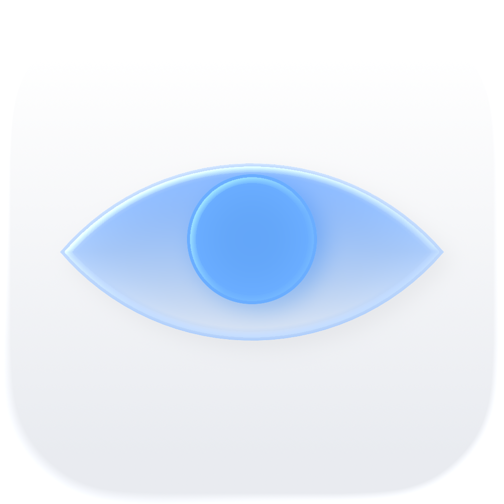
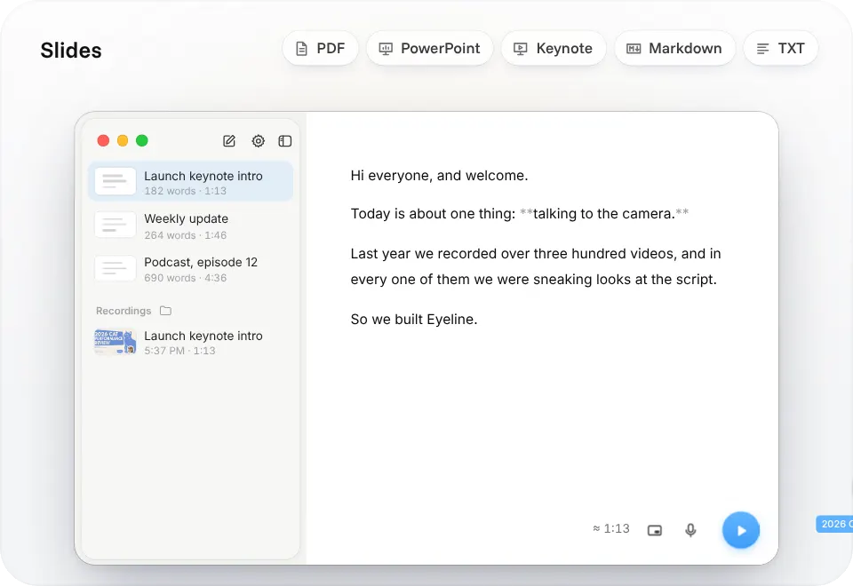

<h1 align="center"><a href="https://eyeline.ooooomo.com/">Eyeline</a></h1>

The best Mac menu bar teleprompter <a href="README.zh.md">简体中文</a>

<a href="https://github.com/omniomo/eyeline/releases/latest"><b>Download</b></a> · macOS 14 or later · <a href="LICENSE">MIT</a>

