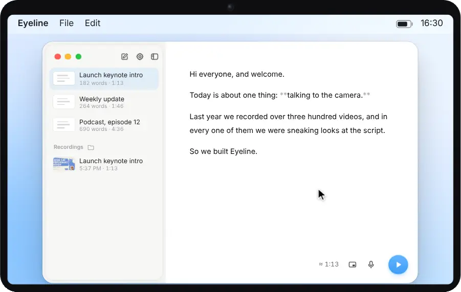

  
  <h3>Eyeline</h3>
  
The best Mac menu bar teleprompter

  

    <a href="https://github.com/omniomo/eyeline/releases/latest"><b>Download</b></a> ·
    <a href="https://eyeline.ooooomo.com/">Website</a> ·
    <a href="README.zh.md">简体中文</a>
  

   
  

## Install

Download the dmg from the [latest release](https://github.com/omniomo/eyeline/releases/latest) and drag Eyeline into Applications. macOS 13 or later, Apple silicon and Intel.

## Privacy

Eyeline doesn't go online and collects nothing. It uses the speech recognition built into macOS: when your Mac can recognize speech on device, your voice never leaves it. [Privacy policy](https://eyeline.ooooomo.com/privacy/)

## Donate

If Eyeline helps you: [GitHub Sponsors](https://github.com/sponsors/omniomo)

## License

[MIT](LICENSE)
