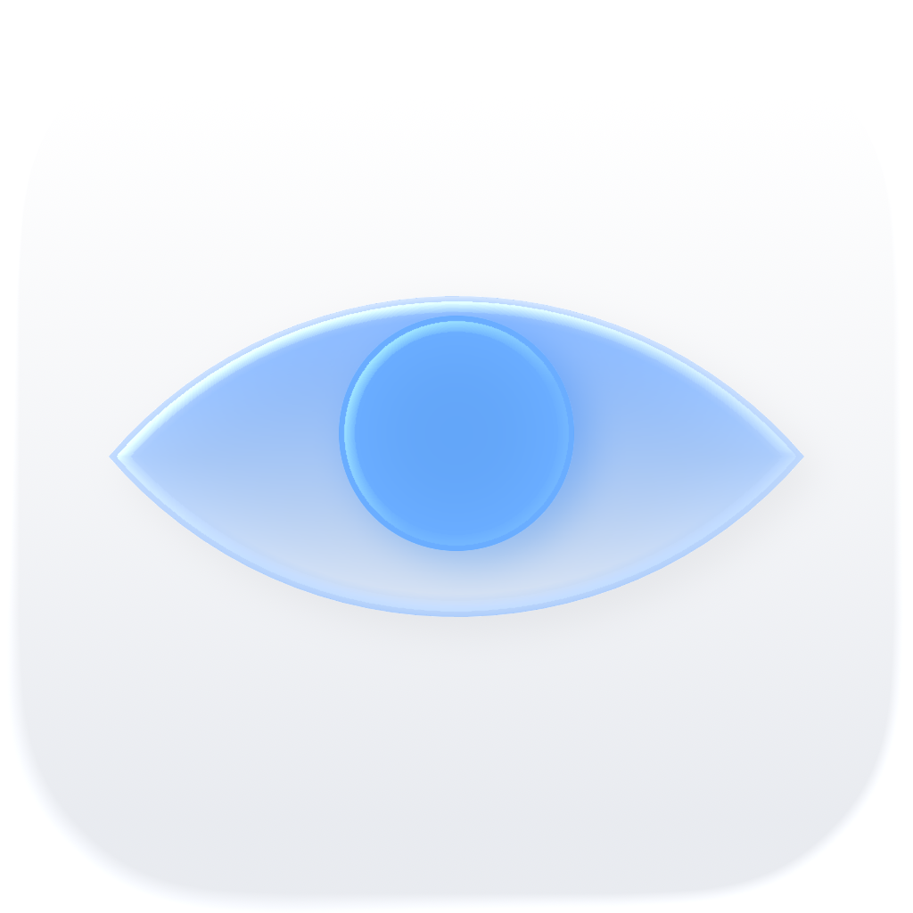
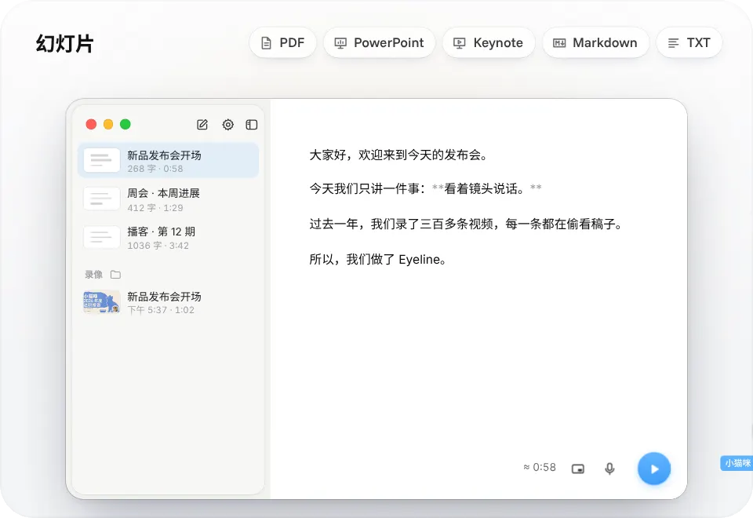

<h1 align="center"><a href="https://eyeline.ooooomo.com/zh/">Eyeline</a></h1>

Mac 最棒的顶部栏提词器 <a href="README.md">English</a>

<a href="https://github.com/omniomo/eyeline/releases/latest"><b>下载</b></a> · macOS 14 及以上 · <a href="LICENSE">MIT</a>

